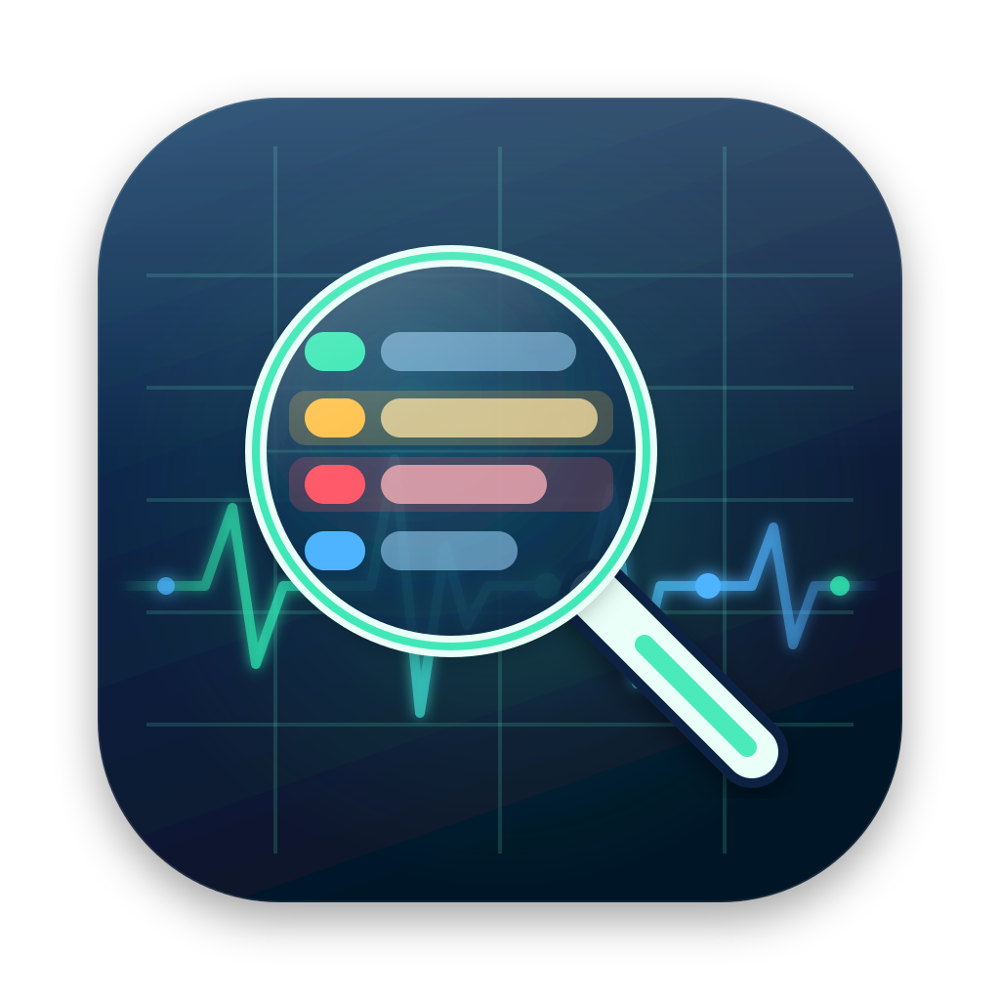

<p align="center">
  
</p>

<h1 align="center">LANA Traffic Analyzer</h1>
<p align="center"><b>Нативный анализатор сетевого трафика для macOS</b> — функции в духе Wireshark без перегруженного интерфейса. Компаньон <a href="https://github.com/V1p3rL0rd/LANA-scanner">LANA Scanner</a>.</p>

<p align="center">
  
  
  
  
</p>

<p align="center"><a href="README.md">English version</a></p>

---

SwiftUI + AppKit, libpcap, собственные диссекторы на Swift. macOS 14+, Apple Silicon (Intel — через `UNIVERSAL=1` при наличии полного Xcode).

## Архитектура

```
 /dev/bpf* ──► libpcap (CaptureEngine, поток "lana.capture")
                   │  батчи RawPacket (pcap_dispatch, immediate mode)
                   ▼
        CapturePipeline (serial queue "lana.analysis")
          Dissector (stateless, L2→L7)  ──►  AnomalyEngine (stateful: TCP, ARP, сканы)
          + live display filter                     │ ExpertInfo (error / warning / note)
                   │  pending buffer (lock)         ▼
                   ▼
        CaptureSession (@MainActor, drain 4 Гц) ──► NSTableView (подсветка строк)
                                                 ├─► дерево протоколов + hex (пере-диссекция по клику)
                                                 └─► панель аномалий (агрегаты)
```

Ключевые решения:

| Решение | Почему |
|---|---|
| libpcap вместо прямого BPF ioctl | `pcap_compile` даёт полноценный BPF-синтаксис, pcap/pcapng I/O и DLT разных интерфейсов из коробки; входит в macOS SDK |
| Собственные диссекторы | без GPL-зависимостей и установки Wireshark; ~45 протоколов разбираются полностью, остальные из каталога (185 шт.) опознаются по порту/EtherType |
| Хранится только `RawPacket` + `PacketSummary` | дерево протоколов строится заново по клику — память ≈ размер трафика + ~200 Б на пакет |
| NSTableView вместо SwiftUI `Table` | миллионы строк без лагов и подсветка всей строки (SwiftUI Table на macOS 14 так не умеет) |
| ChmodBPF (группа `access_bpf`) | GUI не работает под root; та же модель, что у Wireshark, совместима с его установкой |

### Поддерживаемые интерфейсы (DLT)

| Интерфейс | DLT | Разбор |
|---|---|---|
| `en*` Ethernet / Wi-Fi | EN10MB | Ethernet II, 802.3/LLC/SNAP, VLAN/Q-in-Q |
| `en*` в monitor mode | IEEE802_11_RADIO | Radiotap + 802.11 (mgmt/ctrl/data, SSID, deauth) |
| `lo0` | NULL | BSD loopback |
| `utun*`, `ipsec*` (VPN, WireGuard, Tailscale) | RAW / NULL | IPv4/IPv6 |
| `bridge*`, `vmenet*`, `awdl0`, `llw0` | EN10MB | как Ethernet |
| pcap/pcapng-файлы | + LINUX_SLL/SLL2, PPP | Linux cooked capture, PPP |

### Разбор протоколов

- **L2:** Ethernet, LLC/SNAP, 802.1Q/ad, ARP/RARP, MPLS, PPPoE, LLDP, CDP, STP/RSTP/MSTP, LACP, EAPOL, 802.11
- **L3:** IPv4 (опции, фрагменты), IPv6 (цепочка extension headers), ICMP, ICMPv6/NDP/MLD, IGMP, GRE (вкл. ERSPAN/PPTP), ESP, AH, IP-in-IP, 6in4
- **Маршрутизация:** OSPF, VRRP, BGP, RIP, BFD, PIM/EIGRP (заголовок)
- **L4:** TCP (флаги, опции, анализ последовательности), UDP, SCTP (чанки)
- **L7:** DNS/mDNS/LLMNR/NBNS, DHCP/DHCPv6, NTP, SNMP, Syslog, TFTP, HTTP/1.x, TLS (SNI, ALPN, версия, alerts), QUIC, SSH, FTP, SMTP, POP3, IMAP, Telnet, SIP, RTSP, SSDP, Redis, MQTT, Modbus/TCP, Kafka, WireGuard, VXLAN, Geneve, STUN, IKE/NAT-T, RADIUS

Протокол на нестандартном порту определяется эвристиками (TLS-запись, HTTP-метод, SSH-баннер, QUIC long header).

### Подсветка аномалий

Красный — ошибка, жёлтый — требует внимания. Полный список — в панели «Аномалии» (⌥⌘I).

| 🔴 Ошибка | 🟡 Внимание |
|---|---|
| Malformed/усечённые заголовки, неверные checksum* | TCP retransmission / fast / spurious, out-of-order, dup ACK |
| TCP RST, Zero Window | Previous segment not captured, Window Full, Zero Window Probe, SYN retransmission |
| SYN+FIN, NULL, Xmas-сканы; LAND (src == dst) | FIN-scan, port scan (>100 целей / 5 с), ping sweep |
| ARP: смена MAC у IP (спуфинг) | Gratuitous ARP reply, ICMP/ICMPv6 redirect |
| ICMP unreachable, parameter problem | ICMP TTL exceeded, PMTU / Packet Too Big |
| DNS SERVFAIL/REFUSED/FORMERR | DNS NXDOMAIN, TC, AXFR, подозрительно длинные имена (туннелирование) |
| HTTP/SIP 5xx, TLS fatal alert, SMTP/FTP 5xx | HTTP 4xx, TLS warning alert, TLS ≤1.1, слабый шифр, Heartbeat |
| DHCP NAK, EAP failure, RADIUS reject, BGP NOTIFICATION, BFD down | Открытые учётные данные: HTTP Basic, FTP/POP3 PASS, IMAP LOGIN, Telnet, SNMP v1/v2c community |
| IPv6 RH0, Tiny fragment, TTL 0 | IPv4/IPv6 фрагментация, TTL=1, STP TCN, VRRP prio 0, 802.11 deauth |

\* Проверка checksum по умолчанию выключена: на macOS исходящие пакеты захватываются до checksum offload и выглядят «битыми». Включается в параметрах захвата.

## Установка и сборка

Требования: macOS 14+ и Command Line Tools (`xcode-select --install`). Полный Xcode не обязателен: интерфейс не использует SwiftUI-макросы (`@State`, `#Preview`), плагины которых поставляются только с Xcode.

> Собирайте под своим пользователем, не под root: иначе `.build/` и `build/` станут принадлежать root и следующая сборка упадёт с `Permission denied`.

```bash
# 1. Доступ к BPF без root (один раз; идемпотентно; совместимо с ChmodBPF от Wireshark)
sudo bash Scripts/install-chmodbpf.sh
# выйти из системы и войти снова — чтобы применилась группа access_bpf

# 2. Тесты ядра
swift test

# 3. Сборка .app (arm64, ad-hoc подпись, иконка из Assets/)
bash Scripts/build-app.sh
open build/LANA.app

# Universal (arm64 + x86_64) — только с полным Xcode:
UNIVERSAL=1 bash Scripts/build-app.sh

# Подпись Developer ID для распространения:
SIGN_IDENTITY="Developer ID Application: Org (TEAMID)" ./Scripts/build-app.sh
```

Для разработки (если Xcode установлен): `open Package.swift` → схема `LANA` → Run.

> ⚠️ App Sandbox отключён намеренно: из sandbox открыть `/dev/bpf*` нельзя. Поэтому дистрибуция только вне App Store (Developer ID + notarization).

> ⚠️ Любой член группы `access_bpf` может прослушивать весь трафик хоста. Добавляйте туда только доверенные учётные записи.

## Работа с программой

**Фильтр захвата (⌘K)** — компилируется в BPF и работает в ядре, то есть до копирования пакетов:

- `srcaddr` / `dstaddr` — IPv4, IPv6, CIDR, MAC, имя хоста; несколько значений через запятую (OR)
- «В обе стороны» — захват диалога целиком (A→B и B→A)
- протоколы — 185 штук в 18 категориях, с поиском по имени и номеру порта
- «Свой BPF» — произвольное выражение; проверяется через `pcap_compile` прямо при вводе

Адреса строго валидируются: строка `1.2.3.4 or port 22` будет отклонена, так что подставить лишние BPF-примитивы через поле адреса нельзя.

**Display filter** — синтаксис как у Wireshark (подмножество):

```
ip.addr == 10.0.0.0/8 && tcp.port in {80 443}
dns.qry.name contains "apple" || !arp
http.response.code >= 400
tcp.analysis.retransmission || tcp.analysis.zero_window
expert.error            expert.warning          expert.group == security
tls.handshake.extensions_server_name matches "\.ru$"
```

Операторы: `== != > < >= <=` (`eq ne gt lt ge le`), `contains`, `matches`/`~` (regex), `in {…}`, `&& || !` (`and or not`), скобки. Через контекстное меню строки: фильтр по источнику, назначению, протоколу или диалогу.

**Файлы:** открытие pcap/pcapng (⌘O), сохранение всего (⌘S) или только отображаемых (⇧⌘S) в pcap.

## Проверка

```bash
# 1. права на BPF
ls -l /dev/bpf0                 # crw-rw----  root  access_bpf
id -Gn | tr ' ' '\n' | grep access_bpf

# 2. юнит-тесты: диссекторы, TCP-анализ (вкл. wrap-around seq), ARP-спуфинг, BPF всех 185 протоколов,
#    display filter, pcap round-trip, fuzz на усечённых и случайных кадрах
swift test

# 3. сверка с эталоном (нужен tcpdump/tshark)
sudo tcpdump -i en0 -c 2000 -w /tmp/ref.pcap
# открыть /tmp/ref.pcap в LANA (⌘O); число пакетов должно совпасть с:
tcpdump -r /tmp/ref.pcap 2>/dev/null | wc -l

# 4. проверка подсветки аномалий
curl -s http://127.0.0.1:1 || true      # RST → красная строка (захват на lo0)
dig nonexistent.invalid                  # NXDOMAIN → жёлтая строка
```

## Day-2

- **Логи:** `log stream --predicate 'subsystem == "app.lana"'` (os.Logger: старт/стоп захвата, ошибки pcap).
- **Потери пакетов:** статус-бар показывает «Потеряно ядром» (`pcap_stats` ps_drop + ps_ifdrop). Если растёт — сузьте фильтр захвата: BPF отбрасывает лишнее в ядре. Буфер 16 МБ ограничен `sysctl debug.bpf_maxbufsize`.
- **Память:** лимит пакетов настраивается (по умолчанию 2 млн). При достижении захват останавливается с уведомлением — сохраните pcap и начните заново. Для многочасовых захватов используйте `tcpdump -G/-C` с ротацией и открывайте файлы в LANA.
- **Откат прав:** `sudo ./Scripts/uninstall-chmodbpf.sh [--remove-group]`. Если установлен ChmodBPF от Wireshark, права и группа не трогаются.
- **CI:** `.github/workflows/ci.yml` — тесты и сборка `.app` на macOS плюс тесты ядра на Linux (Swift 5.10).

## Структура

```
Sources/CPcap/             module map для libpcap
Sources/PacketCore/        платформенно-независимое ядро
  Capture/                 CaptureEngine, InterfaceDiscovery, PcapFile, BPFValidator
  Dissect/                 L2, IP, ICMP, Transport, DNS, DHCP, TLS/QUIC, Text (HTTP…), Misc, WLAN
  Analysis/                AnomalyEngine (TCP/ARP/сканы), PacketProcessor
  Filter/                  ProtocolCatalog, CaptureFilter (→BPF), DisplayFilter
Sources/LANA/              SwiftUI-приложение
Tests/PacketCoreTests/     XCTest
Scripts/                   install/uninstall-chmodbpf.sh, build-app.sh
Assets/                    иконка (AppIcon.svg — исходник, .png, .icns)
```

## Лицензия

[MIT](LICENSE) © 2026 Vianor Gvazbaya
